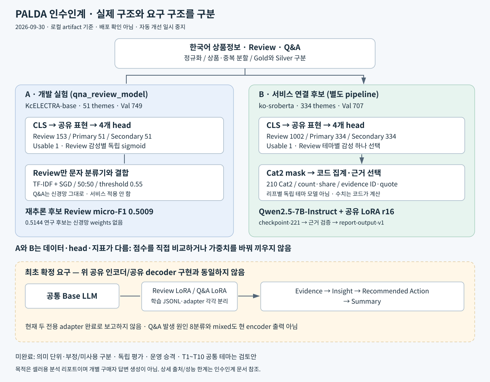

# 모델 아키텍처와 입출력 계약

편집 가능한 원본은 [architecture.mmd](architecture.mmd)다. 그림의 A/B는 인수인계용 계열 구분이다. 병렬로 서비스에 함께 배포됐다는 뜻이 아니다.

## 1. 최초 요구 구조 — 현재 완료로 표시하지 않음

상품정보 + 전처리 통계 + 상품별 Review 원문 묶음 → 공통 Base LLM + Review LoRA → Evidence/Insight/Action/Summary.

상품정보 + 전처리 통계 + 상품별 Q&A 원문 묶음 → 같은 Base LLM + 별도 Q&A LoRA → 같은 리포트 골격.

Review/Q&A 학습 파일과 adapter를 분리하고 개별 구매자 답변을 만들지 않는 것이 요구였다. 실제 확인된 후속 서비스의 공유 인코더·공유 decoder 구조와 구별해야 한다. 저장된 QLoRA legacy smoke artifact 역시 두 리포트 adapter 완료의 증거가 아니다.

## 2. A: KcELECTRA 4-head 개발 모델

`beomi/KcELECTRA-base`의 CLS 표현 → dropout → 아래 head를 사용한다.

| Head | 출력 크기 | 학습/추론 |
|---|---:|---|
| Review theme × sentiment | 51 × 3 = 153 | 독립 BCE/sigmoid, 카테고리 mask |
| Q&A primary | 51 | CE / masked softmax |
| Q&A secondary | 51 | BCE/sigmoid |
| usable | 1 | BCE/sigmoid |

Review/Q&A가 동일한 supervised encoder를 공유한다. LoRA adapter 2개가 아니며 원문 quote를 생성하는 모델도 아니다. task에 해당하는 loss만 사용한다. 기본 loss 계수는 Review 1, primary 1, secondary 0.5, usable 0.2; Review/secondary positive weight 3이다. 실험별 변경은 metrics/config를 우선한다.

기본 학습: AdamW, backbone LR 2e-5 / head LR 1e-4, batch 16, accumulation 2, max_length 256, warmup 0.06. 선택 후보는 6epoch 실행 중 epoch 4다. 6번째 epoch가 저장된 최적 모델이라는 뜻은 아니다. 선택 지표는 Review micro-F1 + Q&A primary accuracy + secondary micro-F1의 합이다.

문자 분류기: char_wb 2~5gram, min_df 2, 최대 40,000 TF-IDF 특성, balanced SGD logistic(alpha 1e-5). Review 신경망과 확률 50:50 결합 후 threshold 0.55. 이 조합의 Q&A는 수정하지 않는다. joblib은 임의 코드를 실행할 수 있으므로 신뢰된 로컬 artifact만 로드한다.

테마별 label attention, mean pooling, Review loss ×3 등의 연구 구현도 있지만 실제 재현 후보의 기본 구조와 섞지 않는다. attention 점수를 Evidence quote의 정당성 증명으로 해석하면 안 된다.

## 3. B: 서비스 연결 인코더

`jhgan/ko-sroberta-multitask` backbone의 CLS → dropout → 4-head. runtime이 확인하는 architecture는 `palda-service-encoder-v2`다. head 크기는 Review 334×3=1,002 / primary 334 / secondary 334 / usable 1이다. max_length 256, 샘플 런타임 기본 batch 64.

필수 artifact: `backbone/`, `tokenizer/`, `heads.pt`, `label_map.json`, `thresholds.json`, `taxonomy.json`, `metrics.json`.

샘플 런타임이 고정한 경로:

`palda-encoder-pipeline/artifacts/gold-anchor-backbone-pilot/ko-sroberta-champion-candidate-test-audit`

실제 서비스 로딩은 `PALDA_ENCODER_DIR`, `PALDA_TAXONOMY_PATH` 등 환경변수로 정해진다. 로컬 sample 스크립트에 이 경로가 있다는 것만으로 운영 배포를 확정하지 않는다. A의 `model_state.pt`와 B의 `heads.pt/backbone` 계약은 호환된다고 가정하지 않는다.

## 4. 코드 집계 계층

Review/Q&A를 분류한 후 상품·테마·감성별 그룹을 만든다. count/share/평점 분포/답변율 등 수치는 가능한 입력에 대해 **전처리 코드가 계산**하고 LLM에는 읽기 전용으로 제공해야 한다. 필요한 원본 필드가 없으면 값을 발명하지 않는다.

현재 runtime의 Q&A 테마 비율은 usable Q&A 전체를 분모로 한 primary 테마 건수다. secondary까지 더해 중복 건수로 바꾸지 않는다. 상위 몇 테마만 보여주면 비율 합이 100%보다 작을 수 있다. Review도 행 수와 테마 언급 수를 구분해야 한다.

입력 한도는 Review 최대 5,000 + Q&A 최대 5,000. 모든 원문을 한 번에 decoder에 넣는 구조가 아니다. 분류 후 대표 근거를 선택한다. pipeline README는 그룹당 대표 5~10개를 설명하고, runtime의 top-group 설정은 Review 감성별 3 / Q&A 4를 사용한다. “전체 원문 수”, “선택 그룹 수”, “그룹당 근거 수”는 서로 다른 제한이다.

집계가 선택한 evidence ID와 원문 substring이 리포트의 출처여야 한다. 원문에 인용문이 존재한다는 것만으로 요약을 지지한다는 의미 검증까지 끝나는 것은 아니다.

## 5. C: 실제 존재하는 생성 LoRA

샘플 runtime은 `palda-decoder-pipeline/artifacts/decoder-imported-v2-qwen2.5-7b/checkpoint-221`을 사용한다.

- Base: Qwen/Qwen2.5-7B-Instruct.
- LoRA: r=16, alpha=32, dropout=0.05.
- 대상 모듈: q/k/v/o_proj, gate/up/down_proj.
- 입력: 테마별 근거·집계·task instruction. 출력: 리뷰/문의 요약, 근거 기반 소구점.
- 학습 task: review_summary, qna_summary, selling_point를 포함한 공유 adapter 계열.
- 기록: Train 3,522 / Val 462, seed 42, train_loss 0.19237, 학습 시간 약 1,388초. 이 loss는 리포트 의미 정확도가 아니다.
- runtime sample은 4bit 로딩을 설정한다. tokenizer의 chat_template.jinja를 사용하며 인계 때 template을 임의 교체하지 않는다.

Qwen3-8B는 앞선 draft 생성과 라벨링 이력에서 등장한다. 지금 확인한 서비스 샘플의 생성 base인 **Qwen2.5-7B-Instruct**와 혼동하지 않는다.

## 6. 의미 검증·출력 계약의 남은 간극

런타임은 `report-output-v1`을 조립한다. grounded_v2 실험에서는 observed/expectation/conditional, evidence span ID, intent 집계와 속성 평가 분리를 시도했다. 이는 실험 wrapper이며 기본 운영 경로에 자동 반영됐다고 단정할 수 없다.

최초 요구의 evidence_id → insight.evidence_ids → action.insight_ids 연결, Q&A 문의 발생 원인, Review mixed, 통계/quote 전체 검증은 후속 책임자가 계약별로 다시 확인해야 한다. 현재 실험 개선과 최초 모든 기능 완료를 등치하지 않는다.
